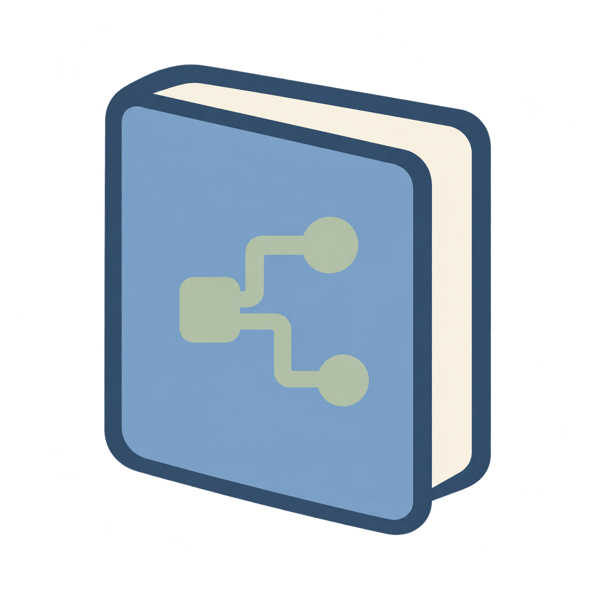
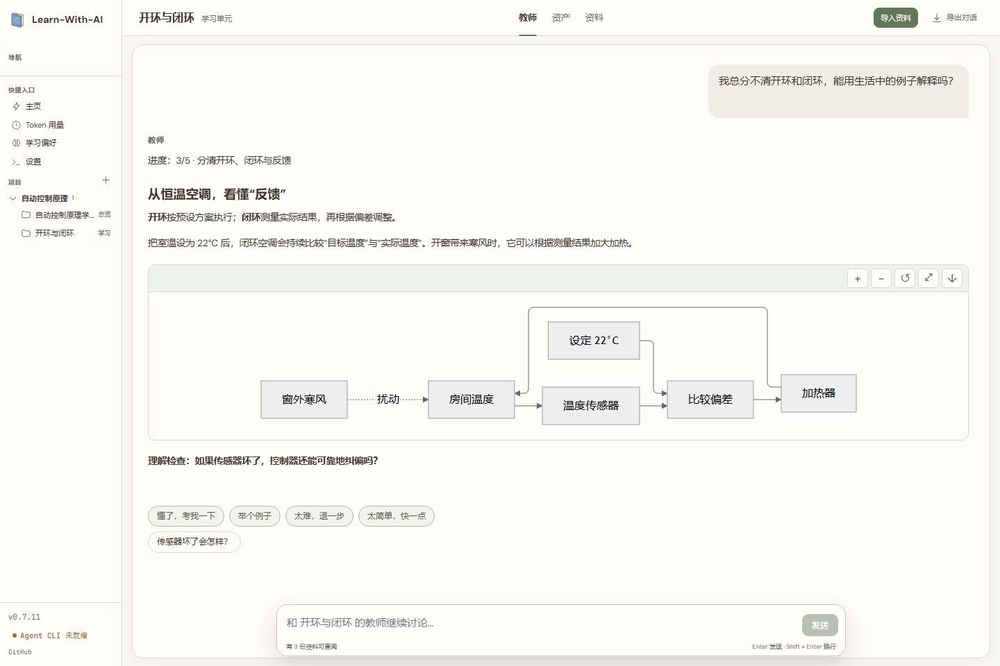
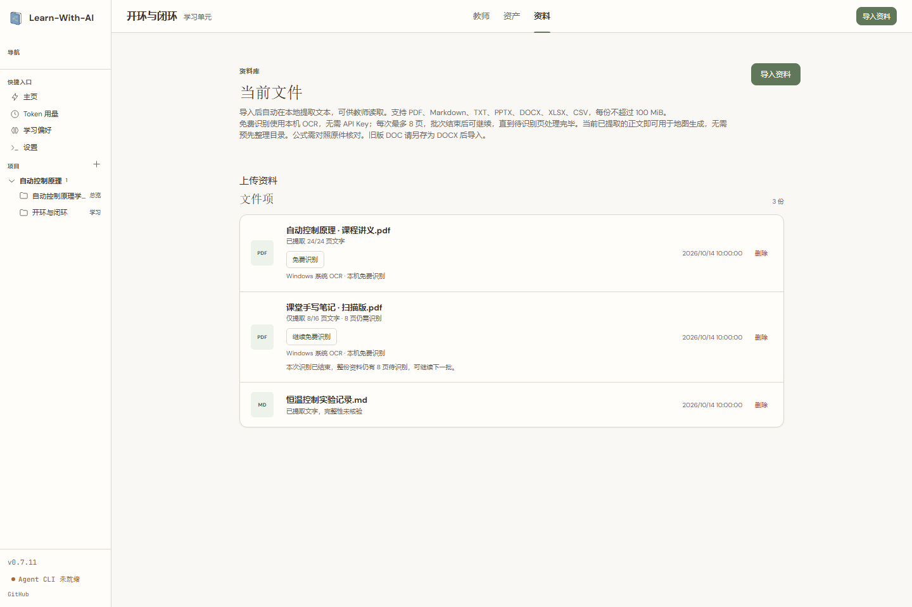
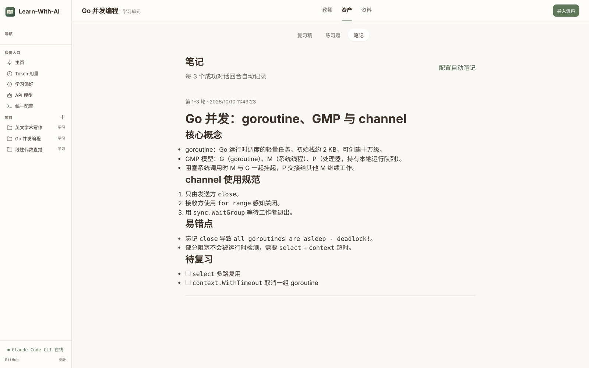
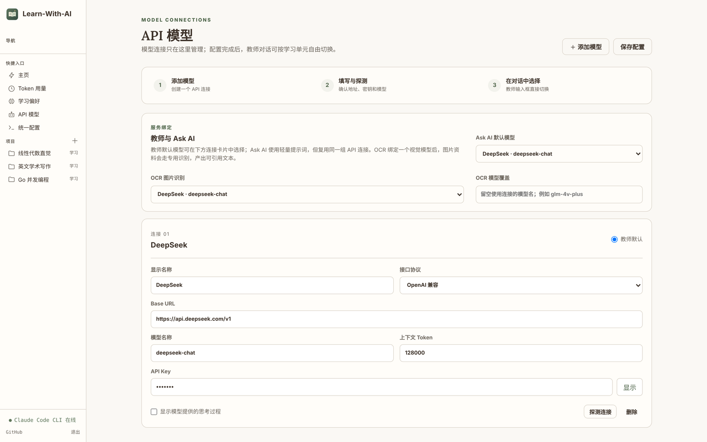
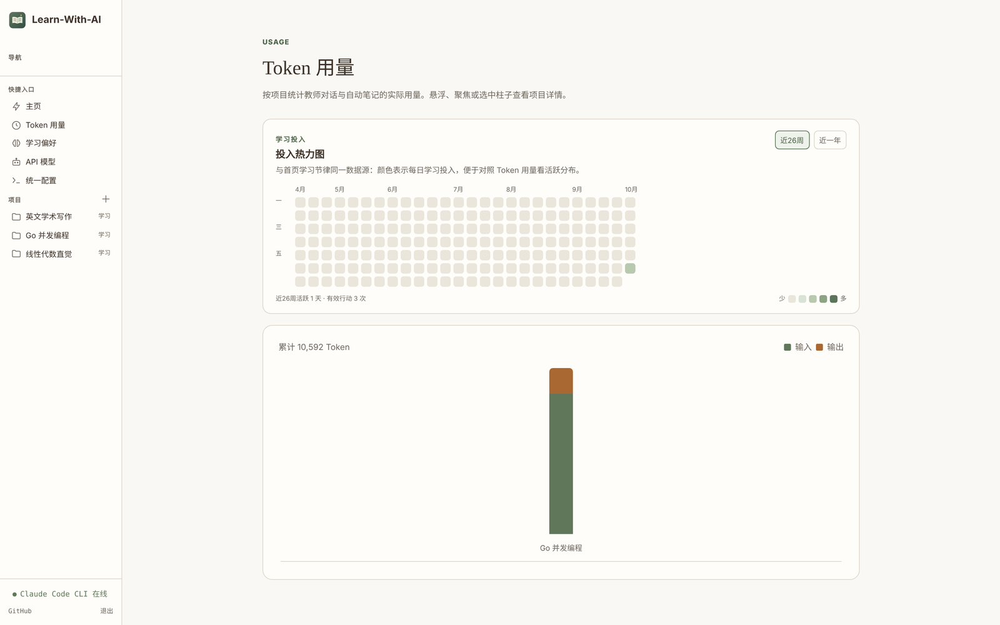
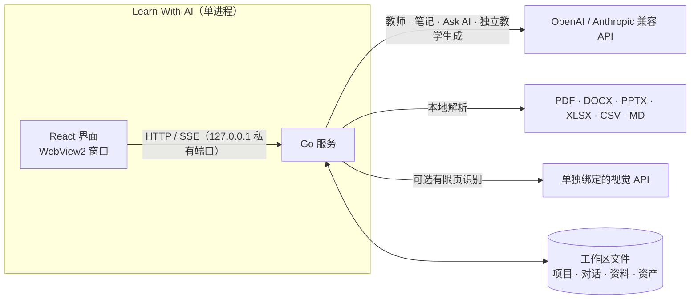

<div align="center">



# Learn-With-AI

**本地优先的 AI 学习工作台：和 AI 教师对话，把理解沉淀成自己的复习稿、练习题和笔记。**

*A local-first AI learning workbench — learn by talking with an AI teacher, keep what you understood.*

[](https://github.com/porridgeowefish/LLL_life_long_learn/releases/latest)
[](https://github.com/porridgeowefish/LLL_life_long_learn/actions/workflows/ci.yml)
[](./LICENSE)


[下载安装](#-下载安装) · [使用流程](#-使用流程) · [从源码构建](#-从源码构建) · [常见问题](#-常见问题)



</div>

## ✨ 特性

- **AI 教师对话**：围绕一个学习单元持续提问、澄清、验证；支持流式回复、Markdown、表格、代码、LaTeX、Mermaid，模型可在对话框内随时切换。
- **资料即上下文**：导入 PDF、Markdown、TXT、PPTX、DOCX、XLSX、CSV，本地解析成文本，上传后自动可查阅，教师按目录、检索和连续原文逐步读取，提供可核对的引用；本地解析不经过云端服务。
- **自动笔记**：每 3 个成功回合（可调）由教师模型总结一次，记录关键概念、易错点与待复习项。
- **复习稿与练习题**：在资料页独立调用 API 生成，可选模型、资料与题数，显示生成进度；答案折叠在题目下。可编辑、回溯版本，支持分页阅读、划词批注与 Ask AI。
- **按资料组织学科地图**：选择模型直接生成章节，或先导入参考资料再生成；保持已有学习计划。
- **学习节律与用量**：首页热力图记录每日投入，Token 用量按项目统计输入与输出。
- **本地优先**：所有项目、对话、资料和配置都是本机上的普通文件，无数据库、无账号；API Key 只保存在本地配置中。
- **原生桌面应用**：Windows 提供标准 MSI 安装包与独立应用窗口（WebView2），支持版本检测、覆盖确认、修复与卸载，并能在应用内一键更新。

## 📸 截图

| 资料库：本地解析，教师可读取 | 自动笔记：每 3 轮沉淀一次 |
| --- | --- |
|  |  |
| **统一设置：服务预置与默认模型** | **Token 用量与学习投入** |
|  |  |

<sub>截图使用示例项目「Go 并发编程」的演示数据。</sub>

## 📦 下载安装

前往 [**Releases**](https://github.com/porridgeowefish/LLL_life_long_learn/releases/latest) 下载与系统对应的安装包。安装包已包含前端、后端和文档解析器，无需另装 Go、Node.js、Python 或 Office。

| 系统 | 安装包 | 说明 |
| --- | --- | --- |
| Windows 10/11 x64 | `learn-with-ai-<版本>-windows-amd64.msi` | 推荐。原生应用窗口 |
| Windows on ARM | `learn-with-ai-<版本>-windows-arm64.msi` | 原生应用窗口 |
| macOS | `…-darwin-<arch>.pkg` / `…-app.tar.gz` | 当前在默认浏览器中打开界面 |
| Debian / Ubuntu | `…-linux-<arch>.deb` | `sudo apt install ./文件名.deb` |
| 其他 Linux | `…-linux-<arch>-install.tar.gz` | 解压后运行 `./install.sh` |

每个版本都附带 `SHA256SUMS`，可用 `Get-FileHash`（Windows）或 `sha256sum -c`（Linux/macOS）校验。

### Windows 安装

1. 双击 `learn-with-ai-<版本>-windows-amd64.msi`。
2. 按向导阅读许可协议，安装到固定目录（`%LOCALAPPDATA%\Programs\learn-with-ai`，仅当前用户，无需管理员权限，不能修改安装地址）。
3. 完成后从**桌面**或**开始菜单**打开 **Learn-With-AI**。

> 应用依赖 Microsoft Edge **WebView2 Runtime**（Windows 11 与大多数 Windows 10 已自带）。缺少时安装程序会明确提示，可从 [微软官方页面](https://developer.microsoft.com/microsoft-edge/webview2/) 安装 Evergreen Runtime 后重试。当前安装包尚未代码签名，SmartScreen 提示时选择“更多信息 → 仍要运行”。

### 自动更新

从 0.5.2 起，应用启动时会检查 GitHub 上的新版本。发现新版本后，侧栏底部会出现“发现新版本”提示；点击 **立即更新**，应用会下载安装包、用 Release 的 `SHA256SUMS` 校验、在后台静默安装，并在完成后自动重新打开。也可以在 **设置 → 版本与数据** 中手动检查更新。

### 学习数据保存在哪里

项目、对话、笔记、资料、学习偏好和 API 配置都保存在 `%LOCALAPPDATA%\learn-with-ai`（在 **设置 → 版本与数据** 中可以看到完整路径）。更新、修复和卸载都不会修改或删除这个目录。

### 升级与覆盖安装

也可以直接运行新版本 MSI。安装程序会**检测已安装的版本**，弹出“确认升级或覆盖安装”对话框，确认后才替换程序文件；选择取消则不做任何修改。

- 同一版本再次运行 MSI 会进入**维护模式**，可选择修复或删除；
- 不允许用旧版本覆盖新版本（降级会被拒绝）；
- 检测到旧版 EXE 安装时会先征求确认再迁移；
- 学习数据始终保留。

### 查看本地已安装版本

- **设置 → 应用 → 已安装的应用**，搜索 Learn-With-AI，可看到版本号；
- 或在 PowerShell 中执行：

  ```powershell
  Get-ItemProperty HKCU:\Software\learn-with-ai\Installer | Select-Object Version, InstallLocation
  ```

### 卸载

以下任一方式均可：

- **设置 → 应用 → 已安装的应用 → Learn-With-AI → 卸载**；
- 再次运行同版本 MSI，选择“删除”；
- 命令行：`msiexec /x learn-with-ai-<版本>-windows-amd64.msi`。

卸载只移除程序文件和快捷方式。学习项目、笔记、资料和 API 配置保存在 `%LOCALAPPDATA%\learn-with-ai`，不会被删除；确认不再需要后可手动删除该文件夹。

## 🧭 使用流程

1. **配置模型**：进入「设置」，点击添加连接，在弹窗选择提供方和模型、填写 Key，探测并保存；自定义连接可填写完整参数。
2. **新建项目**：点击侧栏「项目」旁的 `+`，为一个主题创建学习单元，例如「Go 并发编程」。
3. **导入资料**：在项目右上角「导入资料」，上传讲义、课件或表格。解析完成后自动供教师使用，无需另点添加或引用。
4. **和教师对话**：在「教师」标签提问。教师会结合资料讲解、给出示例，并用小问题检查你的理解。
5. **回顾与沉淀**：选择资料与模型生成复习稿或练习题，设置题数并查看进度；展开每题下方答案，或在复习稿中划词批注和追问。
6. **组织学科**：在学科地图选择直接生成或按参考资料生成章节，再进入相应学习单元。

数据默认位置：Windows `%LOCALAPPDATA%\learn-with-ai`；macOS `~/Library/Application Support/learn-with-ai`；Linux `$XDG_DATA_HOME/learn-with-ai` 或 `~/.local/share/learn-with-ai`。

## 🏗 工作原理



- **后端**：Go 1.26，标准库 HTTP 服务，文件即数据库，重启后从文件恢复任务状态。
- **前端**：Vite + React 18 + TypeScript，TanStack Query 管理服务端状态，单一 SSE 通道推送事件。
- **桌面**：Windows 版在同一进程内启动 Go 服务并用 WebView2 打开原生窗口；关闭窗口后留在后台，单击托盘图标恢复，右键托盘图标选择退出。同一工作区只允许一个实例。
- **打包**：GitHub Actions 在各平台原生构建；Windows MSI 由 WiX 生成，并在发布前完成真实的安装、修复、升级、降级拒绝、启动和卸载测试。

## 🛠 从源码构建

前置：Go ≥ 1.26、Node.js ≥ 20。

```bash
git clone https://github.com/porridgeowefish/LLL_life_long_learn.git
cd LLL_life_long_learn
npm install --prefix frontend
npm run build      # 构建前端到 frontend/dist/，并编译后端到 dist/dev/
npm run start      # 启动服务，浏览器打开 http://127.0.0.1:8787/
```

| 命令 | 作用 |
| --- | --- |
| `npm run dev --prefix frontend` | 前端热更新（:5173，代理到 Go :8787） |
| `npm run run` | 直接 `go run` 后端 |
| `npm run build:desktop` | Windows：构建带图标的原生桌面开发版 |
| `npm run stop` | 停止本地服务 |
| `node tools/release/build-release.js --version 0.6.1 --installers` | 在本机生成发布包（Windows 上生成 MSI） |

源码运行时数据默认写入仓库内的 `workspace/`（已被 Git 忽略），可用 `--workspace` 或 `LLL_WORKSPACE_ROOT` 指定其他目录。

## ❓ 常见问题

<details>
<summary><b>打开后提示需要 WebView2 Runtime</b></summary>

安装微软官方的 WebView2 Evergreen Runtime 后重新打开即可。应用不会退回到普通浏览器标签页。
</details>

<details>
<summary><b>提示“workspace is already open”</b></summary>

同一个工作区只能被一个 Learn-With-AI 实例使用。已打开的窗口会被切换到前台；如果是源码版服务占用，先执行 `npm run stop`。
</details>

<details>
<summary><b>扫描版 PDF 或旧版 DOC/PPT/XLS 无法读取</b></summary>

扫描件没有可提取文字层时，可在设置中绑定文档公式识别模型，再使用有限页识别；复杂公式需要按原页核对。旧版 Office 格式请另存为 DOCX/PPTX/XLSX 后再导入。单个文件上限100MiB。
</details>

<details>
<summary><b>API Key 存在哪里？会上传吗？</b></summary>

API Key 只保存在本机工作区的 `config.local.json` 中，仅用于直接请求你配置的模型服务。项目本身没有服务器，也不收集任何数据。
</details>

## 🤝 参与贡献

欢迎通过 [Issues](https://github.com/porridgeowefish/LLL_life_long_learn/issues) 报告问题或提出建议，Pull Request 的流程见 [CONTRIBUTING.md](./CONTRIBUTING.md)。

## 📄 许可证

[MIT](./LICENSE) © 2026 Xiong Minzhe
