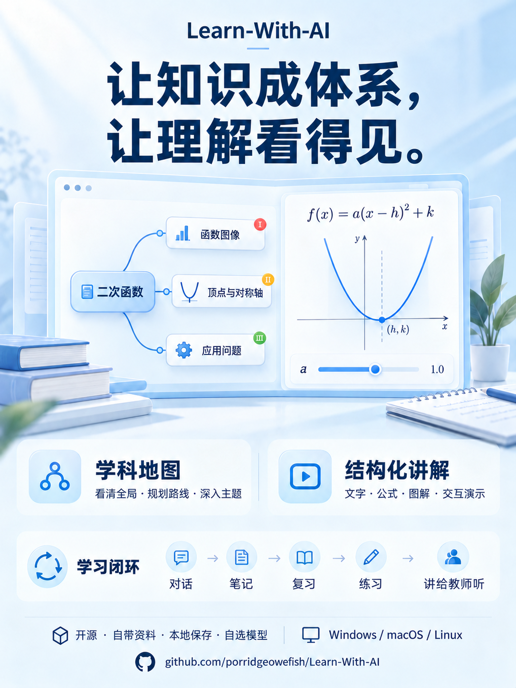
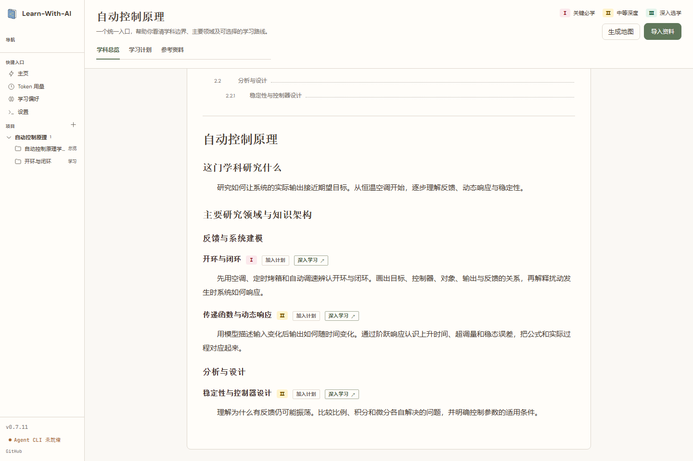
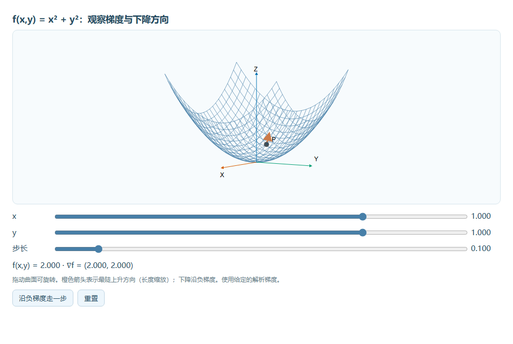
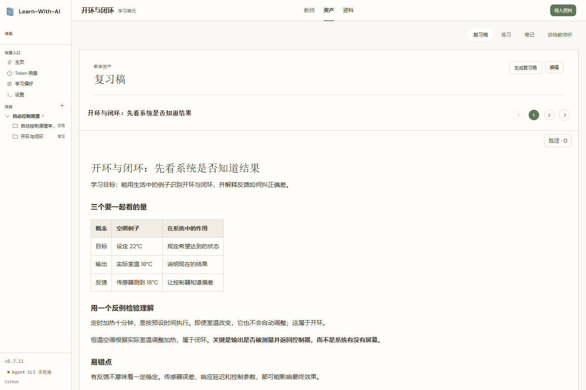
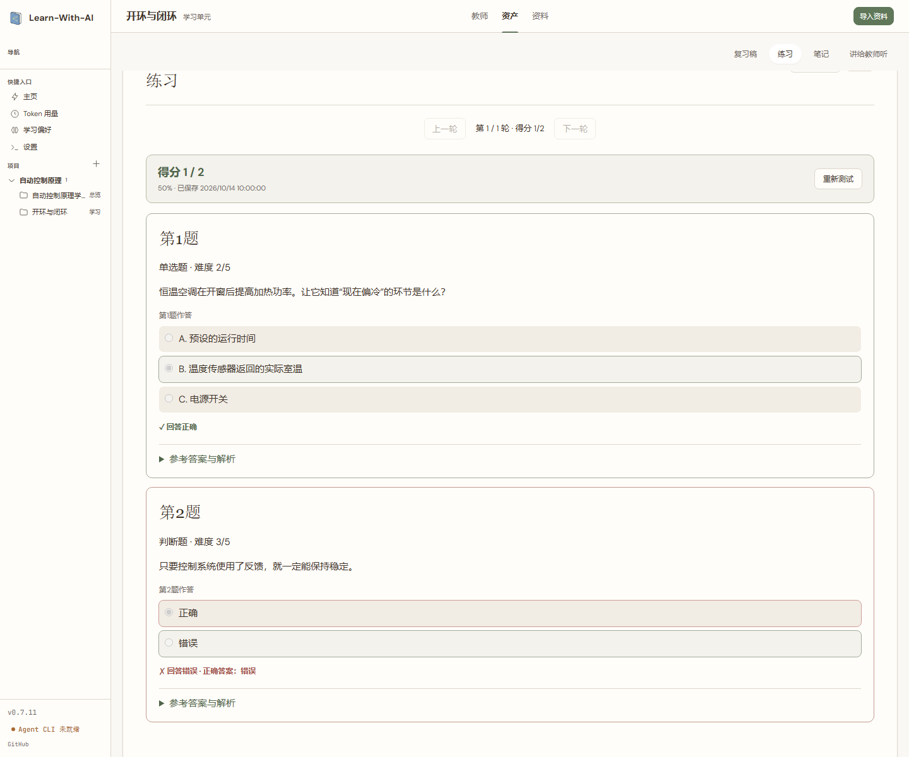
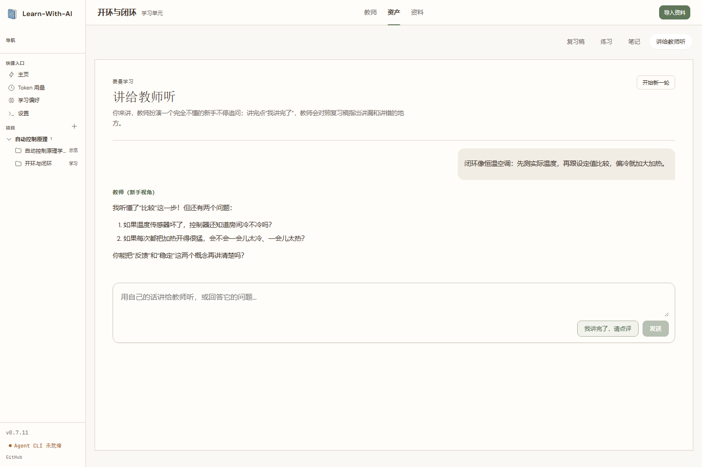
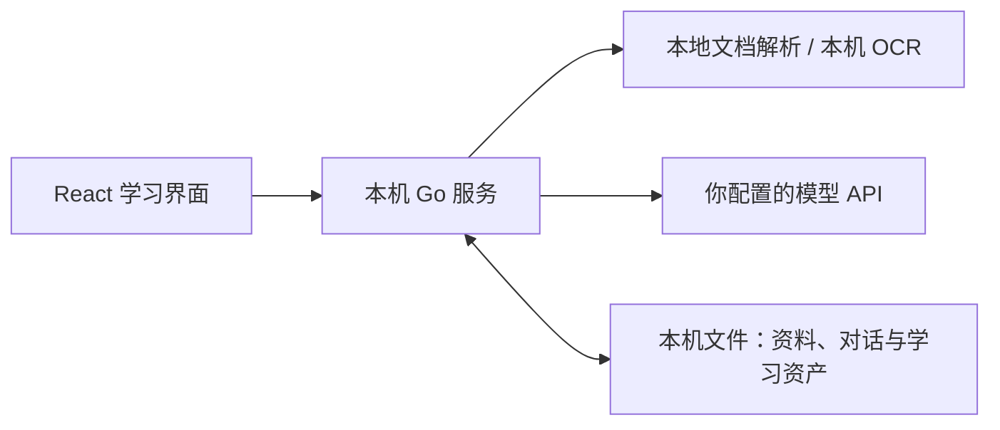

<div align="center">


# Learn-With-AI

**从“看过了”，到“能讲清楚”。**

用学科地图看清知识体系，用文字、公式、图解与交互演示理解概念，再通过笔记、复习、练习和「讲给教师听」检验掌握。可以带上自己的教材，也可以从一个问题开始。

*Map the subject. Explore the idea. Explain it in your own words.*

[](https://github.com/porridgeowefish/Learn-With-AI/releases/latest)
[](https://github.com/porridgeowefish/Learn-With-AI/actions/workflows/ci.yml)
[](./LICENSE)


**[下载安装](https://github.com/porridgeowefish/Learn-With-AI/releases/latest)** · [看一次完整学习过程](#功能演示) · [从源码构建](#从源码构建)



<sub>海报为功能示意。下方界面截图来自自动控制原理演示项目，教材名称、对话与学习内容均为人工编排的演示数据，不是现场模型生成结果。点击图片可查看大图。</sub>

</div>

## 为什么用它学习

学一门新知识，往往卡在几个地方：不知道先学什么、读懂了却说不清、聊完一大段又找不到重点。Learn-With-AI 把这些环节放进同一个本地工作台。

| 你遇到的问题 | 可以怎么做 |
| --- | --- |
| 想系统学一门学科，不知道边界和路线 | 生成学科地图，看领域关系、先修知识与学习优先级 |
| 一本教材很厚，不知道从哪开始 | 导入资料，按已识别正文组织地图，再选择主题深入 |
| 定义看懂了，脑中却没有画面 | 让教师用公式、表格、关系图或 SVG 图解说明 |
| 想知道改变一个参数会发生什么 | 请教师生成交互演示，拖动滑块、点击按钮观察变化 |
| 对答案觉得会了，自己做却出错 | 先作答再提交测试，查看得分、正确答案与解析 |
| 聊过很多，第二天记不住 | 回看自动笔记，生成复习稿，留下批注与追问 |
| 想知道自己是否真的理解 | 反过来讲给教师听，让它从新手视角追问 |

**资料、对话、笔记和学习资产保存在本机普通文件中。** 应用不需要自有云账号；模型连接由你选择。

### 核心能力一览

| 能力 | 你能得到什么 |
| --- | --- |
| **学科地图** | 学科边界、主要领域、主题关系、先修知识与三级优先级；主题可加入计划或进入独立学习单元 |
| **结构化讲解** | 文字、数学公式、表格、代码、关系图与 SVG 图解；内置数学交互引擎，支持2D函数、3D曲面与梯度演示 |
| **AI 教师** | 新学习单元主动开场，逐个知识点讲解；可以追问、换例子、补基础 |
| **自己的参考资料** | 多格式导入、本地解析、原文引用、免费本机 OCR；显示真实识别范围，支持删除原件与解析文字 |
| **自动笔记与复习稿** | 记录理解变化与疑问；复习稿支持分页、编辑、版本记录、划词批注和 Ask AI |
| **练习与反馈** | 按学习内容生成题目，选择题量，提交客观题后查看得分、答案、解析与历史成绩 |
| **讲给教师听** | 用自己的话解释，接受新手视角的追问，再获取讲解点评 |
| **连接与用量管理** | 自选兼容模型连接、切换教师模型、按项目查看用量；学习成果保存在本机 |

## 开始使用

前往 [**Releases 下载页**](https://github.com/porridgeowefish/Learn-With-AI/releases/latest)，选择对应系统与架构的安装包。安装包包含前端、后端和文档解析器，无需安装 Go、Node.js、Python 或 Office。

| 系统 | 选择的文件 | 启动方式 |
| --- | --- | --- |
| Windows 10/11 x64 | `…-windows-amd64.msi` | 从桌面或开始菜单打开原生应用窗口 |
| Windows on ARM | `…-windows-arm64.msi` | 原生应用窗口 |
| macOS Intel / Apple Silicon | `…-darwin-<arch>.pkg` / `…-app.tar.gz` | 界面在默认浏览器中打开 |
| Debian / Ubuntu | `…-linux-<arch>.deb` | `sudo apt install ./文件名.deb` |
| 其他 Linux | `…-linux-<arch>-install.tar.gz` | 解压后运行 `./install.sh` |

1. **先体验，再配置。** 打开主页的「体验示例」，跟着梯度下降示例试问答、复习和练习，无需 API Key。
2. **接入自己的模型。** 在「设置」添加连接，选择提供方与模型，填写 Key，探测后保存。
3. **选一种起点。** 想弄懂一个具体问题，新建学习单元；想系统学习一门学科，新建学科地图。
4. **带上自己的资料。** 导入教材、讲义或笔记，再开始提问、复习与测试。

> 教师对话和内容生成需要可用的模型连接，费用取决于你选择的服务。自带示例和本地文档解析无需模型请求；扫描页的本机 OCR 无需 API Key，具体可用性取决于系统环境。

<details>
<summary><b>Windows 安装、更新与卸载</b></summary>

双击 MSI，按向导阅读许可并安装。程序固定安装到 `%LOCALAPPDATA%\Programs\learn-with-ai`，仅当前用户使用，无需管理员权限。Windows 窗口依赖 [Microsoft WebView2 Runtime](https://developer.microsoft.com/microsoft-edge/webview2/)；缺少时，安装程序会提示安装。当前包尚未代码签名，系统可能显示 SmartScreen 提示，请先核对下载来源。

应用启动时会检查新版本；可点击侧栏「立即更新」，或在「设置 → 版本与数据」手动检查。下载会按 Release 的 `SHA256SUMS` 校验。也可以运行新版本 MSI，在确认升级或覆盖后替换程序文件。

同版本 MSI 提供修复或删除；降级会被拒绝。关闭应用窗口会隐藏到托盘，右键托盘图标可退出。

卸载可通过 Windows「设置 → 应用 → 已安装的应用」，或再次运行同版本 MSI 选择删除。卸载仅移除程序及快捷方式，学习数据保留。每个 Release 都提供 `SHA256SUMS`；Windows 可用 `Get-FileHash` 核对下载文件。

</details>

## 功能演示

以「自动控制原理」为例，从一份讲义开始，走到能解释反馈为什么起作用。你也可以先生成学科地图，再带着选好的主题开始学习。

### 1. 把教材带进来

导入 PDF、Markdown、TXT、PPTX、DOCX、XLSX 或 CSV，教师就可以查阅解析后的资料，并在对话中提供原文引用。每份文件最大 100 MiB。

扫描资料可用本机免费 OCR，每批最多 8 页，完成后继续下一批。**已有的正文就能用于地图生成，不必先手工整理出目录。** 复杂公式仍需对照原页核验。


### 2. 先看全局，再选一个主题深入

**学科地图是整门学科的总览入口。** 它说明这门学科研究什么、边界在哪里、有哪些主要领域、领域之间怎样联系，以及常用方法与典型应用。小节按自然段展开，帮助你理解每个主题的作用。

生成地图可以选择两种组织方式：

- **按学科组织：** 无需先上传教材，围绕学科本身建立知识体系。
- **按参考资料组织：** 选择自己的教材或讲义，从已解析、已识别的正文归纳结构。普通 OCR 文字也能使用，无需手工提供结构化目录；资料尚未识别完整时会说明覆盖缺口。

每个小节带有学习优先级，页面右上角提供图例：**红色 Ⅰ = 关键必学，黄色 Ⅱ = 中等深度，绿色 Ⅲ = 深入选学。** 主题的学习目标、知识范围与先修关系帮助你选择下一步。

把感兴趣的主题「加入计划」，或点击「深入学习」进入独立学习单元。重新生成地图会保留已有学习计划。

比如先学「开环与闭环」，再连接到「动态响应」和「稳定性」。你知道这一节在整个体系中的位置，也知道接下来可以学什么。



### 3. 用结构化讲解，把抽象概念看明白

**教师的回复可以包含文字、公式、图解和可操作的演示。** 新建学习单元后，教师会主动开场，按知识点推进；你可以随时要求换个例子、补充先修知识或进一步解释。

| 回复形式 | 适合怎样的学习 |
| --- | --- |
| Markdown 文字、表格与代码 | 拆解步骤、比较概念、展示推导或程序 |
| 数学公式 | 阅读方程、符号、计算过程与数学推导 |
| Mermaid 关系图与流程图 | 看清反馈回路、概念联系和执行顺序 |
| SVG 图解 | 直观说明几何关系、系统结构或示意图 |
| 交互 HTML 演示 | 拖动参数、点击按钮、观察曲线或模拟变化；可展开图示查看 |
| 2D / 3D 数学控件 | 调节函数参数、旋转曲面，观察函数值、梯度与沿负梯度的变化 |

例如，可以问：“用反馈回路图说明恒温空调怎么工作”，也可以问：“做一个可调参数的演示，让我观察二次函数的图像如何变化。”模型生成符合格式的内容后，应用会直接渲染；具体形式和质量取决于模型与问题。

数学交互引擎基于 [JSXGraph](https://jsxgraph.org/)，随应用提供并按需加载。AI可以直接写代码创建函数图像和可旋转的三维曲面，不用另装插件或连接CDN。例如：“演示二元函数的梯度，让我调节当前点，并沿负梯度走一步。”控件会联动显示函数值、梯度与坐标；使用数值近似时会标明，仍需对照数学定义核验。



<sub>数学控件示例：使用固定函数与解析梯度运行真实渲染器，无模型请求。图中按钮和滑块在应用内可操作。</sub>


### 4. 把理解留下来，复习时接着追问

在资产页选择资料和模型，生成复习稿。正文支持分页、编辑、版本记录和划词批注；遇到一句没弄懂的话，可以直接 Ask AI。公式、表格与 Mermaid 图示都可以保留在学习内容中。



**自动笔记记录理解变化与待复习项。**

教师默认每 3 个成功对话回合总结一次，可在设置中调整。笔记记录关键概念、易错点与下一次复习的问题，保存在该学习单元中。


### 5. 先做题，再看自己错在哪里

按资料生成练习，可选择模型和题数，并查看生成进度。客观题提交后自动判分，再显示答案和解析；多轮练习与已保存成绩可以回看，也可以重新测试。

下面特意答错了「只要有反馈就一定稳定」：**绿色标出正确题，红色标出错误题，帮你找到需要再理解的概念。**



### 6. 换你当老师，看看能不能讲清楚

打开「讲给教师听」，用自己的话解释刚学的内容。AI 教师扮演新手继续追问；讲完点击「我讲完了，请点评」，它会对照复习稿检查讲漏或讲错的地方。

从“反馈就是把结果送回来”，继续讲到“传感器坏了怎么办”“为什么有反馈还会振荡”，把模糊的熟悉感变成可以检查的解释。



**想先试一次？** [下载安装](https://github.com/porridgeowefish/Learn-With-AI/releases/latest)，打开主页的「体验示例」，不用配置模型也能体验主要阅读和练习交互。

## 数据与使用边界

- **本地保存。** 项目、对话、资料、笔记与配置以普通文件保存，更新、修复和卸载保留学习数据。
- **自己选择模型。** 应用支持 OpenAI / Anthropic 兼容 API；教师模型可在对话中切换，用量按项目统计。
- **明确联网范围。** 本地解析和本机 OCR 不需要把文档传到云端。教师对话、Ask AI、内容生成或可选云端识别，会向你配置的服务发送所需内容；本地优先不等于模型离线运行。
- **保留判断。** 模型讲解、答案和 OCR 结果都可能有误，重要内容应对照原文核验。

| 系统 | 学习数据默认位置 |
| --- | --- |
| Windows | `%LOCALAPPDATA%\learn-with-ai` |
| macOS | `~/Library/Application Support/learn-with-ai` |
| Linux | `$XDG_DATA_HOME/learn-with-ai` 或 `~/.local/share/learn-with-ai` |

完整路径可在「设置 → 版本与数据」查看。API Key 保存在本机工作区的 `config.local.json`，仅用于请求你配置的模型服务。

## 从源码构建

需要 Go ≥ 1.26、Node.js ≥ 20.19。

```bash
git clone https://github.com/porridgeowefish/Learn-With-AI.git
cd Learn-With-AI
npm install --prefix frontend
npm run build
npm run start
```

构建产物位于 `frontend/dist/` 与 `dist/dev/`；源码服务默认打开 `http://127.0.0.1:8787/`。数据默认写入仓库内被 Git 忽略的 `workspace/`，可用 `--workspace` 或 `LLL_WORKSPACE_ROOT` 指定其他目录。

| 命令 | 用途 |
| --- | --- |
| `npm run dev --prefix frontend` | 前端热更新，默认 :5173，代理到 Go :8787 |
| `npm run run` | 直接运行 Go 后端 |
| `npm run build:desktop` | Windows 原生桌面开发版 |
| `npm run stop` | 停止本地源码服务 |

<details>
<summary><b>工作原理</b></summary>



后端使用 Go 标准库 HTTP 服务，以文件保存状态。前端为 Vite + React 18 + TypeScript，通过 HTTP / SSE 更新界面。Windows 在同一进程内运行 Go 服务和 WebView2 窗口；macOS 与 Linux 在默认浏览器打开本地界面。同一工作区只允许一个写入实例。

</details>

## 常见问题

<details>
<summary><b>没有 API Key，能先体验吗？</b></summary>

可以。主页「体验示例」包含预置问答、复习、练习、笔记、资料与地图，无需 API。本次体验的数据关闭后重置。自己的教师对话与内容生成仍需配置可用模型连接。

</details>

<details>
<summary><b>扫描 PDF 能识别吗？旧版 Office 格式呢？</b></summary>

扫描件可使用 Windows 系统中文 OCR、macOS Vision 或 Linux Tesseract。缺少中文语言包或识别引擎时，资料页会提示。也可以配置云端文档识别模型；公式与复杂排版需要对照原件核验。旧版 DOC/PPT/XLS 请先另存为 DOCX/PPTX/XLSX。

</details>

<details>
<summary><b>关闭窗口后，程序还在运行吗？</b></summary>

Windows 关闭窗口会隐藏到托盘，点击托盘图标恢复，右键选择退出。提示「workspace is already open」说明同一个工作区已被实例占用；源码版可执行 `npm run stop`。

</details>

<details>
<summary><b>可以删除导入的资料吗？</b></summary>

资料行提供永久删除确认，会删除原件、解析文字、识别页图和历史解析版本，无法恢复。已生成的地图和学习内容会保留。

</details>

## 参与贡献

欢迎通过 [Issues](https://github.com/porridgeowefish/Learn-With-AI/issues) 报告问题或提出建议。贡献流程见 [CONTRIBUTING.md](./CONTRIBUTING.md)。

[MIT](./LICENSE) © 2026 Xiong Minzhe
